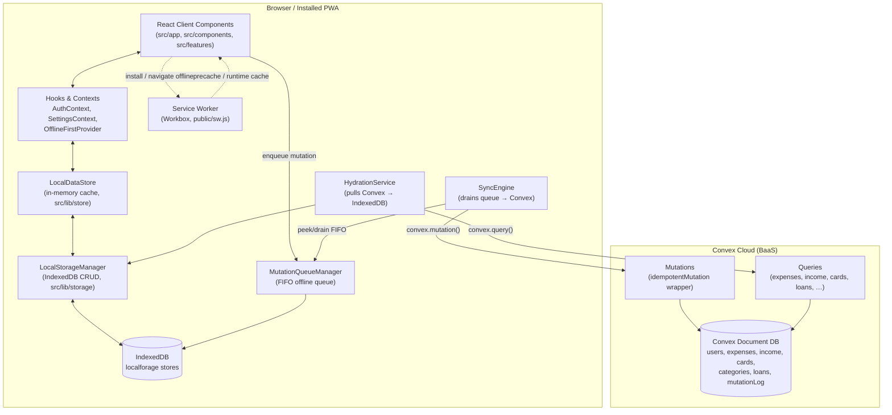

# Spendly — Architecture & System Design

**Version documented:** 1.3.6 · **Last generated:** 2026-09-23

This document is the single source of truth (SSoT) for the architecture of
**Spendly**, an offline-first personal finance PWA. It is written for future
AI-assisted development sessions and human contributors alike — read it
before making structural changes, and keep it in sync with the code.

> For Convex-specific coding rules, always read `convex/_generated/ai/guidelines.md`
> first, per the project's `CLAUDE.md`.

---

## 1. Executive Overview & Core Purpose

Spendly is a mobile-first **Progressive Web App** for tracking personal
expenses, income, cards/accounts, and installment loans. It targets users
who need the app to work reliably with **flaky or absent connectivity**
(the README and codebase both treat "works offline" as a first-class
requirement, not a fallback).

Key product traits visible in the code:

- **Bilingual / dual-calendar**: English (Gregorian) and Persian/Farsi
  (Jalali calendar) are both first-class — see `jalali-moment`, the
  `IRANSansXV` font, `src/components/date-pickers/PersianDatePicker.tsx`,
  and `calendar`/`language` fields in `userSettings`.
- **Multi-currency**: `userSettings.currency` supports `USD | EUR | GBP | IRR`.
- **Offline-first, not merely offline-tolerant**: every read and write goes
  through a local IndexedDB store first; a background sync engine reconciles
  with Convex opportunistically. The app is fully usable with zero network.
- **Installable PWA**: `next-pwa` + Workbox service worker, app-shell
  precaching, install prompts, and a custom update-notification system.
- **Domain**: expenses, income, cards (accounts/wallets), category
  management, card-to-card transfers, and installment loans with automatic
  payment tracking.

Target platform: mobile browsers and installed PWA (iOS/Android/desktop),
served as a Next.js "standalone" build (see `output: "standalone"` in
`next.config.js`, suited to containerized hosting) with static assets on a
CDN-fronted edge (Cloudflare-aware comments in `next.config.js`).

---

## 2. Technology Stack & Key Dependencies

| Layer | Technology | Notes |
|---|---|---|
| Framework | **Next.js 16.3.0** (App Router, webpack build — `next dev/build --webpack`, not Turbopack) | `src/app/**` |
| UI runtime | **React 19.2.8** / React DOM 19.2.8 | Client components dominate; see §3 |
| Language | **TypeScript** (TS 6.0.3) | `tsconfig.json`, path alias `@` → `src/` |
| Styling | **Tailwind CSS v4** (`@tailwindcss/postcss`) | `tailwind.config.ts`, `globals.css`, `critical.css` inlined for fast first paint |
| Backend / BaaS | **Convex** (`convex` ^1.43.0) | `convex/` — schema, queries, mutations; real-time subscriptions via `convex/react` |
| Local persistence | **localforage** (IndexedDB wrapper) | `src/lib/storage/idb.ts`, multiple named stores |
| Offline auth cache | Custom `OfflineTokenManager` + `crypto-js` | Encrypts the session token at rest for offline login |
| Forms & validation | **react-hook-form** + **zod** + `@hookform/resolvers` | Client-side validation; Convex `v.*` validators enforce server-side |
| Charts | **chart.js** + **react-chartjs-2** | Dashboard analytics (category breakdown, daily spending) |
| Dates/calendars | **date-fns**, **jalali-moment**, **react-multi-date-picker** | Gregorian + Jalali dual calendar support |
| PWA / offline | **next-pwa** (Workbox: precaching, routing, strategies, background-sync, expiration) | `next.config.js`, `public/sw.js`, `public/background-sync-sw.js`, `src/lib/pwa/**` |
| Import/export | **xlsx** | Data export (`src/components/settings/ExportButton.tsx`) |
| Notifications | **sonner** | Toast notifications (lazy-loaded) |
| Motion | **framer-motion** | Transitions/animations |
| Icons | **lucide-react** | |
| Testing | **Jest 30** + **@testing-library/react** + **fake-indexeddb** | `jest.config.js`, `tests/` |
| Lint | **ESLint 10** (`eslint-config-next`) | `eslint.config.mjs` |
| Hosting | Standalone Next.js output, Cloudflare-aware config (comments reference Cloudflare Workers deploy quirks) | `next.config.js` |
| Package manager | npm (`package-lock.json` present) | |

---

## 3. High-Level System Architecture & Component Diagram

**Pattern**: Client-heavy SPA-over-App-Router, backed by a serverless
**BaaS (Convex)**, with a **local-first data layer** interposed between the
UI and the network. Every page is effectively a static client shell —
there is no server-rendered, per-user HTML; all Convex calls happen from
the browser.



### Request/response & real-time flow

1. **Read path**: Components read from `LocalDataStore` (an in-memory
   snapshot of IndexedDB), not directly from Convex `useQuery`. This makes
   every screen render instantly from disk, online or offline.
2. **Write path**: A user action calls a hook (e.g. `useExpenseForm`) which
   writes **optimistically** to `LocalStorageManager` (IndexedDB) and
   **enqueues** the same operation in `MutationQueueManager`. The UI never
   waits on the network.
3. **Background sync**: `SyncEngine` listens for connectivity/queue events
   and drains the queue **in strict FIFO order**, calling the matching
   Convex mutation via a raw `ConvexClient` (not React hooks, since it runs
   outside the component tree). Each mutation carries an `idempotencyKey`
   (the queue item's UUID).
4. **Reconciliation**: `HydrationService` periodically (on reconnect, tab
   focus, and a 5-minute timer) pulls every collection from Convex and
   merges it into IndexedDB, using **last-write-wins** (via `updatedAt`)
   and skipping any row with unsent local changes.
5. **Convex real-time subscriptions** (`useQuery`) are used sparingly —
   mainly for auth (`getCurrentUser`) — because the primary data path is
   the local-first store, not live Convex queries.

---

## 4. Directory Structure & Code Organization

```
convex/                      Convex backend: schema, queries, mutations
  schema.ts                  All 9 tables + indices (source of truth for data model)
  auth.ts                    Username/password auth, tokens, recovery codes
  expenses.ts                Expense CRUD, categories, "for" tags
  cardsAndIncome.ts          Cards, income, income categories, transfers
  loans.ts                   Loans + installment payments
  userSettings.ts            Currency/calendar/language preference
  idempotency.ts             `idempotentMutation()` wrapper (dedupe replayed writes)
  internal.ts                Internal-only Convex functions
  _generated/                Convex codegen (api, dataModel, server) — do not edit

src/
  app/                       Next.js App Router pages (route = folder)
    dashboard/, expenses/, income/, cards/, loans/, add/,
    settings/, onboarding/, login/, register/, forgot-password/,
    reset-password/, offline/, test-pwa/
    layout.tsx               Root layout: provider tree, fonts, metadata, PWA meta
    globals.css / critical.css
  components/                Shared, reusable UI components (buttons, inputs,
                              sheets, headers, date pickers, nav)
    add/, cards/, categories/, date-pickers/, expenses/, income/, settings/
  features/                  Feature-scoped UI + hooks + types (screen-level modules)
    dashboard/                 AnalyticsTabs, Charts, ExpenseList, SummaryCards, …
    loans/                     LoanCard, LoanForm, PayInstallmentSheet, …
  contexts/                  React Context providers (Auth, Settings)
  providers/                 App-wide providers (Convex client, offline-first wiring)
  hooks/                     Cross-cutting hooks (forms, sync status, online status,
                              debounce, card actions, backup, PWA registration)
  lib/
    auth/                     OfflineTokenManager (encrypted offline session cache)
    pwa/                      Service-worker registration, update-state machine,
                               app-shell warm-up, bounded RSC fetch plugin
    queue/                    MutationQueueManager (offline FIFO write queue)
    storage/                  LocalStorageManager, IndexedDB setup, migrations, locks
    store/                    LocalDataStore (in-memory cache over IndexedDB)
    sync/                     SyncEngine, HydrationService, tombstones, phase locks
    settings/                 Local settings persistence
    types/                    Local-storage type definitions
    formatters.ts, validation.ts, connectivity.ts, clipboard.ts, localDataReset.ts
  types/                      Ambient/module type declarations (e.g. xlsx.d.ts)
  utils/                      Small pure helpers (dashboard aggregation, etc.)

public/                      Static assets, PWA manifest, generated service workers
  sw.js                       next-pwa-generated entry (imports background-sync-sw.js,
                               sw-version.js — do not hand-edit)
  background-sync-sw.js       Hand-written custom SW logic (background sync additions)
  manifest.json                Web app manifest (installable PWA metadata)
  icons/                       App icons

tests/                       Jest test suites (unit + integration, incl. PWA/service-
                              worker timeout and cache-poisoning regression tests)
```

**Conventions observed:**
- `src/components` = generic/reusable; `src/features/<domain>` = screen-specific
  composition (component + hook + types colocated per feature).
- Business/domain hooks live in `src/hooks` (cross-feature) or
  `src/features/<domain>/hooks` (feature-local).
- All local persistence, sync, and queueing code is isolated under `src/lib`,
  never imported directly by page components — always through a context
  (`OfflineFirstProvider`) or a narrow hook.
- `convex/_generated/**` and the SW files listed above are generated —
  never hand-edit them.

---

## 5. Data Architecture & Schema Design

### 5.1 Convex schema (`convex/schema.ts`)

| Table | Key fields | Indices | Notes |
|---|---|---|---|
| `users` | `username`, `hashedPassword`, `tokenIdentifier`, `hasSeenOnboarding?`, `hashedRecoveryCode?`, `recoveryCodeCreatedAt?` | `by_username`, `by_token`, `by_recovery_code` | Auth root. Token-based sessions (no JWT). |
| `expenses` | `amount`, `title`, `category: string[]`, `for: string[]`, `date`, `createdAt`, `userId`, `cardId?`, `loanId?`, `installmentIndex?`, `updatedAt?` | `by_user`, `by_user_date`, `by_card`, `by_loan` | `loanId` + `installmentIndex` pair doubles as the idempotency key for installment payments. |
| `categories` | `name`, `userId`, `isArchived?`, `updatedAt?` | `by_user`, `by_user_name` | Expense categories; archived rather than hard-deleted when in use. |
| `forValues` | `value`, `userId` | `by_user`, `by_user_value` | Free-text "for whom" tags on expenses. |
| `cards` | `name`, `userId`, `createdAt`, `isArchived?`, `updatedAt?` | `by_user`, `by_user_name` | Represents an account/wallet/card that expenses & income attach to. |
| `income` | `amount`, `cardId`, `date`, `source`, `category`, `notes?`, `userId`, `createdAt`, `updatedAt?` | `by_user`, `by_user_date`, `by_card` | |
| `userSettings` | `userId`, `currency: USD\|EUR\|GBP\|IRR`, `calendar: gregorian\|jalali`, `language?: en\|fa`, `updatedAt` | `by_user` | One row per user. |
| `incomeCategories` | `name`, `userId`, `isArchived?`, `updatedAt?` | `by_user`, `by_user_name` | Seeded with defaults (`Salary, Freelance, Investment, Gift, Other`) on registration. |
| `loans` | `name`, `totalAmount`, `totalInstallments`, `paidInstallments`, `installmentAmount`, `monthlyPaymentDay (1-31)`, `startMonth (1-12)`, `startYear`, `userId`, `createdAt`, `updatedAt?` | `by_user` | `paidInstallments` is a derived counter kept consistent with generated `expenses` rows. |
| `mutationLog` | `userId`, `key`, `result`, `createdAt` | `by_user_key` | Idempotency ledger — see §5.3. |

Almost every table carries an optional `updatedAt`, deliberately absent on
rows written before it existed (clients fall back to `_creationTime`). It
drives last-write-wins conflict resolution during hydration (§6.3).

### 5.2 Query/mutation surface

- **`convex/expenses.ts`**: `createExpense`, `updateExpense`, `deleteExpense`,
  `getExpenses`, `getExpensesByDateRange`, `getExpenseById`,
  `createCategory`, `archiveCategory`, `deleteCategory`, `getCategories`,
  `getAllCategories`, `createForValue`, `getForValues`.
- **`convex/cardsAndIncome.ts`**: `addCard`, `updateCard`, `deleteCard`,
  `getMyCards`, `createIncome`, `updateIncome`, `deleteIncome`, `getIncome`,
  `getIncomeByDateRange`, `getIncomeById`, `createIncomeCategory`,
  `archiveIncomeCategory`, `deleteIncomeCategory`,
  `getIncomeCategories`/`getAllIncomeCategories`,
  `getUniqueIncomeCategories`, `getCardBalances`, `transferFunds`.
- **`convex/loans.ts`**: `createLoan`, `updateLoan`, `deleteLoan`,
  `payInstallment`, `getLoans`, `getLoanSummary`.
- **`convex/userSettings.ts`**: `get`, `update`.
- **`convex/auth.ts`**: `register`, `login`, `logout`, `getCurrentUser`,
  `generateRecoveryCode`, `validateRecoveryCode`,
  `resetPasswordWithRecoveryCode`.

All mutations that create/modify user data (everything except `auth.ts`,
which has its own auth-specific handling) are wrapped in
**`idempotentMutation()`** rather than the raw Convex `mutation()`.

### 5.3 Idempotency strategy (`convex/idempotency.ts`)

`idempotentMutation` transparently adds an optional `idempotencyKey` arg. If
present and a valid `token` resolves to a user:
1. Look up `mutationLog` by `(userId, idempotencyKey)` via the `by_user_key`
   index.
2. If found, **return the previously recorded result** without re-running
   the handler (a retried delivery cannot apply twice).
3. Otherwise, run the handler and atomically insert the result into
   `mutationLog` **in the same Convex transaction**.

This is what makes it safe for the client's offline queue to blindly retry
a mutation whose response was lost (crash, dropped connection): the
`idempotencyKey` is the queue item's own UUID, so a retried delivery either
never reached the server (runs normally) or already committed (returns the
recorded result, letting the client still link the created document's
cloud ID).

### 5.4 Auth model

Custom, not Convex Auth: `users.tokenIdentifier` is a random 16-byte hex
token generated server-side and swapped on every login/logout (session
rotation). Passwords are hashed with a simple non-cryptographic hash
function (explicitly commented as "demo purposes" — **flag for hardening**;
see §8). Credential comparisons use `safeEqual` (constant-time over
equal-length strings) to avoid timing side-channels. Recovery codes are
10-character, cryptographically-random (`crypto.getRandomValues`,
rejection-sampled to avoid modulo bias), single-use, and never echoed back
by the unauthenticated validation endpoint (anti-enumeration).

---

## 6. Key Workflows & Business Logic

### 6.1 Add an expense (representative "write" journey)

1. User fills the form in `src/app/add/page.tsx` via
   `useExpenseForm` (react-hook-form + zod schema from `src/lib/validation.ts`).
2. On submit, the hook writes an optimistic row directly into
   `LocalStorageManager` (IndexedDB, `expenses` store) with a locally
   generated `local_…` ID and `syncStatus: "pending"`, then calls
   `LocalDataStore.refresh()` so the UI updates immediately.
3. The same operation is `enqueue()`d into `MutationQueueManager` under
   action key `"expenses:createExpense"`.
4. If online, `SyncEngine`'s queue subscription fires a `drain()`
   immediately; if offline, the item waits.
5. `drain()` pops the head of the FIFO queue, resolves any `local_…` ID
   references to real Convex IDs (`resolveIdReferences`), stamps the
   current auth token + `idempotencyKey`, and calls
   `client.mutation(api.expenses.createExpense, payload)`.
6. On success, `linkCloudIds()` writes the returned Convex `_id` back onto
   the local row (`markEntityAsSynced`) and the item is dequeued.
7. On transient failure (network/timeout/deployment skew), the drain halts
   without burning a retry attempt and resumes on the next trigger.
   On a genuine rejection, the item accumulates `attempts`; after
   `MAX_ATTEMPTS` (5) it moves to a **dead-letter list**, and any optimistic
   local effect is compensated (row flagged `failed`, or — for a rejected
   `payInstallment` — the paid-installment counter is rolled back).

### 6.2 View dashboard / reports

`src/app/dashboard` + `src/features/dashboard/**`. Data comes entirely from
`LocalDataStore` (never a live Convex query) via
`useDashboardData`/`useDashboardDerivedData`/`useDashboardFilters`, so the
dashboard renders instantly offline. Aggregation (category breakdown, daily
spend, summary totals) happens client-side in `src/utils/dashboard.ts` and
feature hooks; charts render with `chart.js`/`react-chartjs-2`
(`CategoryBreakdownChart`, `DailySpendingChart`).

### 6.3 Reconnect / multi-device sync

Handled by `HydrationService.hydrate()`:
1. Fetch all 7 primary collections from Convex in parallel.
2. Build a set of "locally pending" IDs (rows referenced by anything still
   in the mutation queue) so they are never clobbered by a stale server
   snapshot.
3. Merge cards first (other collections rewrite their `cardId` references
   through the resulting cloudId→local-key map), then categories,
   income-categories, `forValues`, loans, expenses, income.
4. Per document: skip if tombstoned (deleted locally, delete not yet
   synced), skip if the local row has unsent changes, otherwise apply
   **last-write-wins** by comparing `updatedAt`.
5. For "deletion-authoritative" collections (`expenses`, `income`, `cards`,
   `forValues`, `loans` — but **not** categories, whose queries filter out
   archived rows), any synced local row absent from the server response is
   deleted, propagating a delete made on another device.
6. The whole fetch+merge runs inside a `runSyncPhase` lock shared with
   `SyncEngine.drain()`, so a hydration pass can never race a drain and
   misclassify a just-synced row as "deleted upstream."

Hydration is triggered on: connectivity regained, tab becoming visible,
and a 5-minute interval — all owned by `OfflineFirstWrapper`.

### 6.4 Offline-first login

`AuthContext` first checks `OfflineTokenManager` for a locally cached,
encrypted (`crypto-js`) token before attempting any network call, granting
**instant offline login** within a grace period. If online, it
background-validates the token against Convex (`getCurrentUser`) with a
2-second timeout and silently falls back to offline mode on timeout rather
than blocking the UI.

### 6.5 PWA / service worker / caching strategy

Built with `next-pwa` (Workbox) — configuration lives in `next.config.js`
and hand-written extensions in `src/lib/pwa/**` and
`public/background-sync-sw.js`. Key decisions, several hardened after past
production incidents (see inline comments and `tests/`):

- **App-shell precaching**: every route (`/add`, `/dashboard`, `/expenses`,
  `/loans`, etc.) is explicitly added to the Workbox precache manifest
  (`APP_SHELL_DOCUMENTS`) with `revision: null` (next-pwa substitutes the
  real build ID), so a cold **offline** launch works immediately after
  install, not just after the user has visited a route online once.
- **`skipWaiting: true` + `clientsClaim: true`**: a new service worker
  activates itself immediately rather than waiting for all tabs to close.
  This is required so the browser's own `sw.js` re-fetch (served
  `max-age=0`) is the one update path guaranteed to reach every device —
  without it, real devices were observed stuck on ancient workers for
  months.
- **Cache-key normalization** (`stripSearchPlugin`, `ignoreURLParametersMatching: [/.*/]`):
  every page in this app is a static client shell where the query string
  never changes the HTML/RSC payload (tabs, edit IDs are read client-side),
  so caching is keyed by pathname only — otherwise `/add?tab=income` would
  miss the cache for `/add`.
- **Route-specific caching strategies**:
  - `/_next/static/*` and images/fonts → `CacheFirst`, long TTL, versioned
    cache names (`CACHE_VERSION = "v3"`, synced between `next.config.js`
    and the SW via a generated `sw-version.js`).
  - Convex/API calls → `NetworkOnly` (backend writes are never cached —
    offline reads/writes go through IndexedDB/the mutation queue, not a
    cached HTTP response).
  - RSC payloads (`?_rsc=…`) → `NetworkFirst` with a **hard-bounded fetch**
    (`boundedRscFetchPlugin` from `src/lib/pwa/rscNetworkTimeout.js`) on top
    of Workbox's `networkTimeoutSeconds`, because `networkTimeoutSeconds`
    alone doesn't abort a genuinely hanging (lie-fi) connection.
  - App/document navigations → `NetworkFirst` (never
    `StaleWhileRevalidate`, to avoid Next.js's build-ID mismatch triggering
    a stale-reload loop after a deploy), 3s timeout, `ignoreVary: true`
    (Next's `Vary: rsc, next-router-*` header would otherwise cause false
    cache misses offline).
  - Offline navigation fallback → static `/offline` page (never `/`, which
    is a blank client-side redirector and caused a white-screen loop).
- **Update notification flow** (`src/lib/pwa/updateState.ts`,
  `usePwaRegistration`): a single module-level flag,
  `markUpdateAvailable()`, is set once a **real replacement** worker takes
  control (`controllerchange`); both the transient toast and the
  persistent Settings "Update" action read this same flag and call the
  same `applyUpdate()` → `reloadPage()`. Dismissing the toast does **not**
  clear the flag (the user can still update from Settings later).
  `applyUpdate()` deliberately never clears caches, unregisters the worker,
  or touches IndexedDB/the mutation queue — offline data must survive an
  update. (Earlier versions used `skipWaiting: true` on the *page* side in
  a way that made the Update button a no-op; the fix was exactly this
  prompt-on-`controllerchange` + plain-reload pattern.)
- **Precache poisoning guard**: a prior "heal precache" helper could
  overwrite a cached URL with a mismatched build revision after a deploy,
  serving stale code; it is now guarded to refuse healing a URL whose
  cached entry belongs to a different revision than the live manifest
  (see `pwa-healprecache-poison` in project memory / `warmAppShell.ts`).
- **`disable: process.env.NODE_ENV === "development"`**: the service
  worker only builds/registers in production; `npm run dev` runs with no
  SW interference.

---

## 7. State Management & Data Flow

| State category | Mechanism | Examples |
|---|---|---|
| Server source of truth | Convex document DB | All persisted user data |
| Local durable cache | IndexedDB via `localforage` (`LocalStorageManager`, `src/lib/storage/idb.ts`) | Expenses, income, cards, categories, loans, settings, mutation queue, dead letters, tombstones |
| In-memory read cache | `LocalDataStore` (singleton, `src/lib/store/LocalDataStore.ts`) | Snapshot of IndexedDB collections; components subscribe to this, not to Convex |
| Pending-write queue | `MutationQueueManager` (IndexedDB-backed FIFO) | Offline/optimistic mutations awaiting sync |
| Cross-tab coordination | `navigator.locks` (`withCrossTabLock`) + an internal `runSyncPhase` lock | Prevents two tabs draining the queue simultaneously; serializes drain vs. hydration |
| React Context (app-wide) | `AuthContext`, `SettingsContext`, `OfflineFirstProvider` | Auth/session, currency/calendar/language prefs, sync status/pending count/failed mutations |
| React Context (infra) | `ConvexProvider`, `OfflineFirstWrapper` | Wires the Convex client and starts/stops `SyncEngine`/`HydrationService` per session |
| Local component state | `useState`/`useReducer` in individual components/hooks | Form state, UI toggles, modal/sheet open state |
| Ephemeral/session-only | `localStorage` | `auth-token`, `cached-user-id` (legacy/back-compat path); the real offline session lives encrypted via `OfflineTokenManager` |
| Live Convex subscriptions | `convex/react` `useQuery`/`useMutation` | Narrowly used — primarily `auth.getCurrentUser` for background token validation, and the direct `login`/`register`/`logout` mutations |

**Optimistic updates**: Every mutation-producing hook writes to IndexedDB
immediately (optimistic), independent of Convex confirmation. There is no
separate "optimistic update / rollback" layer bolted onto Convex's
`useMutation` — the local store *is* the optimistic state, and
`SyncEngine.compensateDeadLetter()` is the rollback path if the server
ultimately rejects a queued mutation.

**Re-renders**: `LocalDataStore` notifies subscribers on every mutation to
IndexedDB (create/update/delete/merge), and React contexts/hooks built on
top of it re-render accordingly — there is no polling.

---

## 8. Security, Auth & Environment Variables

### 8.1 Authentication & authorization

- **Model**: custom username/password auth with a rotating opaque session
  token (`tokenIdentifier`), not Convex Auth, OAuth, or JWT.
- **Server-side enforcement**: every mutation/query that needs a user takes
  a `token: v.string()` arg and resolves it via the `by_token` index
  (`getUserByToken`); there is no `ctx.auth` reliance (deliberately, per
  the comment in `auth.ts`, to keep the lookup visible to Convex's
  reactivity/dependency tracking across isolates).
- **Client-side gating**: `ProtectedRoute` component + `AuthContext` gate
  page access; `middleware.ts` is **not** used (no `src/middleware.ts`
  found) — route protection is purely client-side.
- **Offline session**: `OfflineTokenManager` (`src/lib/auth/OfflineTokenManager.ts`)
  persists an **encrypted** (`crypto-js`) copy of the token with a grace
  period, enabling instant offline sign-in without hitting the network.
- **Password hashing**: `convex/auth.ts` uses a simple non-cryptographic
  hash (explicitly commented "demo purposes... In production, use bcrypt or
  similar"). **This is a known gap, not a hidden one** — treat any
  auth-hardening work as touching `hashPassword`/`hashRecoveryCode` in
  `convex/auth.ts` and requiring a migration for existing users.
- **Anti-enumeration / timing**: login returns an identical error for
  unknown-username vs. wrong-password; `safeEqual` does constant-time hash
  comparison; recovery-code validation never echoes the matched account.
- **Recovery codes**: cryptographically random, single-use, invalidated on
  successful password reset.
- **HTTP security headers** (`next.config.js` → `headers()`): `X-Frame-Options: DENY`,
  `X-Content-Type-Options: nosniff`, `Referrer-Policy: strict-origin-when-cross-origin`,
  a locked-down `Permissions-Policy`, HSTS (`Strict-Transport-Security`),
  and a **Report-Only CSP** (not yet enforced — see the code comment: it's
  staged behind Next's inline bootstrap scripts and inline styles pending
  hash/nonce work).

### 8.2 Environment variables

| Variable | Purpose |
|---|---|
| `NEXT_PUBLIC_CONVEX_URL` | Convex deployment URL; consumed by `ConvexProvider` and `OfflineFirstWrapper` to construct the Convex client. Required for sync to function. |
| `NEXT_PUBLIC_APP_VERSION` | Injected at build time from `package.json` version; surfaces the running build to the client. |
| `NEXT_PUBLIC_SW_CACHE_VERSION` | Mirrors the service worker's `CACHE_VERSION` constant so client code (e.g. app-shell warm-up) writes into the same Workbox runtime caches the SW reads. |
| `NODE_ENV` | Standard Next.js/Node environment flag; also gates whether the service worker is built/registered (`disable` in dev). |

`.env.local` exists in the repo (git-ignored) holding the actual values for
the above — its contents were not read or exposed by this document.

---

## 9. Conventions, Rules & Developer Guidelines

### 9.1 Observed code conventions

- **Path alias**: `@/*` → `src/*` (configured in both `next.config.js`
  webpack alias and `tsconfig.json`).
- **"use client"** is declared explicitly at the top of every
  interactive/context/provider file; there are no server components doing
  data fetching — this app does not use React Server Components for data,
  only for the static shell.
- **Convex mutations that touch user data use `idempotentMutation()`**, not
  the raw `mutation()` — this is a hard convention (see `convex/idempotency.ts`);
  a new mutation that skips it silently loses replay-safety for the offline
  queue.
- **Heavily commented "why", not "what"**: this codebase already follows
  the "comment only for non-obvious constraints" style — most comments
  explain a specific past bug or a subtle invariant (e.g. why `cards` must
  merge before `expenses` during hydration, why `stop()` detaches the
  client before awaiting close). Preserve this style in new code.
- **FIFO + idempotency-key pairing**: any new offline-syncable action must
  be registered in **three** maps in `src/lib/sync/SyncEngine.ts`
  (`ACTION_MAP`, and as applicable `CREATE_TARGET_COLLECTION` /
  `DELETE_TARGET_ID_FIELD` / `UPDATE_TARGET`), or its optimistic local
  writes will never reconcile with the server.
- **Sync-phase locking**: any code that reads/writes IndexedDB collections
  touched by both `SyncEngine` and `HydrationService` should go through
  `runSyncPhase` (`src/lib/sync/syncPhaseLock.ts`) to avoid the exact races
  documented in code comments (drain/hydration interleaving that
  resurrected or deleted rows incorrectly).
- **Tombstones for deletes**: a locally-initiated delete writes a tombstone
  (`src/lib/sync/tombstones.ts`) so hydration doesn't resurrect a row whose
  delete mutation hasn't reached the server yet.

### 9.2 Project-wide rules (from `/Users/wallex/CLAUDE.md`, apply repo-wide)

- Do what has been asked; nothing more, nothing less.
- Never create files unless necessary; prefer editing existing files.
- Never create documentation files unless explicitly requested.
- Never save working files/tests to repo root — use `/src`, `/tests`,
  `/docs`, `/config`, `/scripts`.
- Always read a file before editing it.
- Never commit secrets, credentials, or `.env` files.
- Keep files under 500 lines. *(Note: `src/lib/storage/LocalStorageManager.ts`
  at 1,681 lines and `src/lib/store/LocalDataStore.ts` at 902 lines already
  exceed this — treat any substantial change to either as an opportunity to
  split them, rather than growing them further.)*
- Validate input at system boundaries (Convex `v.*` validators at the
  backend boundary; zod schemas at the form boundary).
- Never add a `Co-Authored-By` commit trailer unless the project's
  `.claude/settings.json` explicitly enables it.

### 9.3 Testing & build

- `npm run dev` — Next dev server (webpack, SW disabled).
- `npm run build` / `npm run build:pwa` — production build (SW enabled).
- `npm test` / `npm run test:watch` / `npm run test:ci` — Jest, using
  `fake-indexeddb` to exercise the storage/sync layers in Node.
- `tests/` includes regression tests for PWA/service-worker behavior
  specifically (e.g. bounded RSC network timeout), reflecting how
  incident-prone this layer has been — new PWA/sync changes should add a
  regression test in the same spirit.
- `npm run lint` — ESLint via `eslint-config-next`.

---

## Appendix: Files worth diagramming further

- `src/lib/sync/SyncEngine.ts` — state machine for drain/retry/dead-letter
  (a sequence or state diagram would help onboard new contributors).
- `convex/schema.ts` + `src/lib/sync/HydrationService.ts` — entity
  relationship + merge-order diagram (cards → categories → forValues →
  loans → expenses → income).
- `next.config.js` `runtimeCaching` array — a routing table diagram
  (URL pattern → Workbox strategy → cache name) would make the caching
  policy much easier to audit at a glance.
- `src/providers/OfflineFirstWrapper.tsx` — sequence diagram of
  app-boot → auth resolve → local store init → sync engine start →
  hydration pull.
